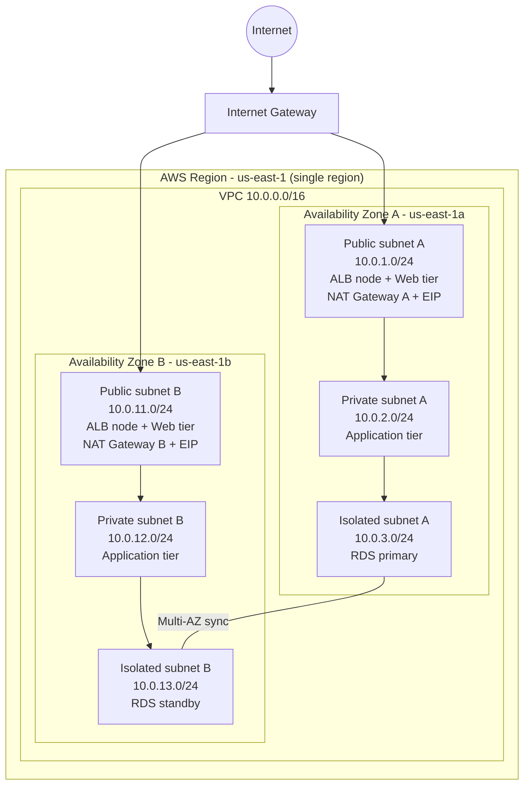

---
tags:
  - microservices
  - cie-2
  - pyq
share_link: https://share.note.sx/g1kuss2q#ur/3piK4xjKe5TjdWHXWT4m/0n0Fw8UN0tLC6gd2q6U
share_updated: 2026-11-17T08:55:53+05:30
---

# Microservices - CIE 2 PYQ and Question Bank

Compiled from every question in the Unit 3 and Unit 4 revision sections of [[cie2notes]], arranged as a practice paper with an answer key.

The **actual Part B test paper** is solved in full in the next section. The compiled question bank follows it.

**Coverage:** infrastructure pipeline, IaC environment, AWS configuration, IaC pipeline, infrastructure components, infrastructure implementation, developer workspace, local containerized setup, Docker, Cassandra, local Kubernetes.

**How to use:**

1. Attempt each section without looking at the notes.
2. Check the answer key and mark what you missed.
3. For a timed mock, pick 8 short, 5 medium and 3 long questions (about 75 marks, 2.5 hours).

| Section | Type | Marks each | Questions |
|---|---|---|---|
| A | Short answer | 2 | 8 |
| B | Medium answer | 5 | 8 |
| C | Long answer | 10 | 8 |

> [!important] Actual CIE-2 paper
> The **Part B test paper** is solved in full below. Questions marked `*` in the margin of the paper were **Q1, Q2, Q4 and Q5** - prioritise those.
> Handwritten hints on the paper: `worker nodes`, `load balancer`, and a `GitLab | GitHub` CI/CD comparison. The hints are decoded at the end of this section.

---

# Part B Test - Actual CIE-2 Paper (with Answers)

| Q | Topic | Marks | Priority |
|---|---|---|---|
| 1 | Challenges of building/hosting microservices locally vs hosted infrastructure | 10 | `*` |
| 2 | Applying DevOps to a team with deployment delays and communication gaps | 10 | `*` |
| 3 | Immutable infrastructure vs traditional infrastructure, with a real-world scenario | 10 | |
| 4 | Need and use of Terraform for IaC and immutable infrastructure | 10 | `*` |
| 5 | AWS three-tier subnet architecture across two AZs with routing tables | 10 | `*` |

---

## Q1. Challenges of building and hosting microservices locally, and why hosted infrastructure is better (10 marks)

**Answer plan:** define the local-vs-hosted distinction (1), list and analyse the challenges (4-5), justify hosted infrastructure under the three headings - scalability, collaboration, deployment efficiency (4-5), close with a trade-off line (1).

### 1. Context

- A microservice application is a **distributed system**: many independently deployable services, each with its own runtime, database and network endpoint.
- "Locally" means running that whole system on one developer machine using Docker Compose, Multipass/VMs, or single-node Kubernetes (Minikube, k3s, MicroK8s).
- "Hosted" means running it on cloud infrastructure - VPC, EKS, managed databases, load balancers - provisioned through IaC and deployed through a CI/CD pipeline.
- The local model is excellent for the **inner development loop** (write, build, run, debug one service). It breaks down when the whole system, or a production-like version of it, must run.

### 2. Challenges faced by development teams locally

| # | Challenge | What actually happens | Impact |
|---|---|---|---|
| 1 | **Hardware ceiling** | A realistic stack has 6-10 services plus Postgres, Cassandra, Kafka, Redis and observability. Cassandra alone needs 6-8 GB; Docker Desktop or a Multipass VM adds overhead. | Throttling, OOM kills, services stopped to free RAM, battery drain, "I can only run 3 services". |
| 2 | **Toolchain and version sprawl** | One service needs Java 17, another Node 20, another Python 3.12 and Go; each needs a different database version. Global installs conflict. | The classic **"works on my machine"** problem; onboarding depends on tribal knowledge. |
| 3 | **Orchestration complexity** | Compose is fine for a handful of containers but service discovery, health checks, startup order, volumes and secrets grow quickly. | Compose files become unmaintainable; developers stop running the full system. |
| 4 | **Local Kubernetes is heavy and awkward** | The official distribution targets a cluster, not a laptop. It has **no image-build tooling**, needs a pre-built image URI from a registry, and has no obvious build-run-test loop (Skaffold only patches this). | High CPU/RAM cost for little development value; slow feedback. |
| 5 | **Networking is not production-like** | Ports, DNS names, service-to-service URLs, TLS, CORS, ALB behaviour, security groups and subnet boundaries are all simplified or absent. | Bugs appear only after deployment; latency and retry behaviour are unrealistic. |
| 6 | **State and data management** | Database volumes, migrations, seed data and broker state must be reset by hand. Test data may be copied from production. | Non-repeatable environments; privacy and compliance risk. |
| 7 | **No production fidelity** | Managed services (RDS Multi-AZ, S3, SQS, IAM, EKS control plane), AZ failure, autoscaling, WAF and cloud load balancers cannot be reproduced faithfully. | Integration, performance and failure testing are unrealistic. |
| 8 | **Slow onboarding and stale docs** | Setup takes days and lives in a README that drifts from reality. | New developers lose momentum; the first week is wasted on environment setup. |
| 9 | **Poor shareability** | A running environment lives on one laptop. Demos, QA and debugging are done through screenshots and pasted logs. | Collaboration and review quality drop. |
| 10 | **Security and audit gaps** | Cloud credentials and production-like data sit on laptops; tools are unpatched; there is no central audit trail. | Compliance exposure. |

### 3. Why moving to hosted infrastructure improves things

#### (a) Scalability

- **Elastic capacity instead of a laptop ceiling.** Cloud compute scales horizontally; EKS/HPA adds pods and the node group/ASG adds worker nodes on demand.
- **Managed services remove operational load.** RDS handles backups, patching and Multi-AZ failover; S3, SQS and ElastiCache are consumed as services instead of being emulated.
- **Realistic performance and resilience testing.** Load tests, chaos experiments and AZ-failure drills run at production scale, which is impossible on one machine.
- **Multi-AZ by design.** Two availability zones keep the system running when one data centre fails; a laptop has no equivalent.
- **On-demand environments.** Sandbox, staging and per-branch preview environments are created in minutes from the same Terraform modules and destroyed afterwards.

#### (b) Collaboration

- **One shared source of truth.** Developers, QA, the release team and operations use the same environment and the same configuration, so "it works for me" arguments disappear.
- **Reproducible onboarding.** Containers plus IaC let a new developer - or an entire environment - be ready in under an hour, matching the first developer-workspace goal.
- **Shared observability.** Central logs, metrics and traces let anyone debug across service boundaries.
- **Parallel work.** PR preview environments and namespaced sandboxes let teams test changes without blocking each other.
- **Remote-ready.** The same setup works on a laptop or a cloud workspace (Guideline 2: remote or local should not matter).
- **Better reviews and demos.** A URL and a shared dashboard replace screenshots; reviewers see real behaviour.

#### (c) Deployment efficiency

- **A single automated path.** IaC and CI/CD mean every change is formatted, validated, planned, applied and deployed by a pipeline - the same way every time.
- **Build once, deploy many.** One immutable container image or AMI is promoted from dev to staging to production, so what was tested is exactly what ships.
- **Immutable infrastructure removes drift.** Environments are re-created from code rather than patched in place.
- **GitOps and fast rollback.** Argo CD reconciles the cluster to Git; rolling back is reverting a commit or redeploying the previous image.
- **Environment parity.** Dev, test and production share the same modules and topology, so defects surface earlier and cheaper.
- **No manual console work.** No clicking in the AWS console, no undocumented SSH steps, and a full audit trail in Git and the pipeline.
- **Cost control through ephemerality.** Short-lived environments are destroyed automatically, so efficiency does not become a permanent bill.

### 4. Trade-offs and the recommended model

| Aspect | Local | Hosted |
|---|---|---|
| Feedback speed | Fastest for one service | Network round trip; slower inner loop |
| Cost | Laptop only | Continuous cloud spend unless environments are ephemeral |
| Fidelity | Low | High |
| Collaboration | Weak | Strong |
| Security | Credentials on laptops | Central IAM, least privilege, audit |

- Hosted infrastructure adds **cost, connectivity dependence and credential risk**. Guardrails are needed: budget alerts, TTL on sandboxes, least-privilege IAM, OIDC instead of long-lived keys, and separate AWS accounts per environment.
- **Best practice is hybrid:** keep the fast inner loop local with Docker Compose (hot reload, debugger), and move integration, end-to-end, performance, security and shared demo environments to the hosted platform.

**Conclusion:** Local hosting is limited by hardware, toolchain sprawl and missing cloud services, and it isolates each developer. Hosted infrastructure turns the platform into shared, reproducible, elastic code - improving scalability, collaboration and deployment efficiency at the cost of money and guardrails.

---

## Q2. How DevOps practices fix deployment delays and communication gaps (10 marks)

**Answer plan:** narrate the current situation and root causes (3), explain the DevOps practices that address each cause (4), narrate the improved workflow with measurable outcomes (2), conclude (1).

### 1. The situation

A traditional team of 12 developers and 4 operations engineers releases once a month. The workflow is a relay race:

- Developers write code on long-lived branches and "throw it over the wall" to operations as a build artifact plus a deployment ticket.
- Operations deploys manually from a runbook, often late at night, and fixes problems by SSHing into servers.
- Development and operations sit in separate teams, use separate tools and are measured on different goals: developers on features shipped, operations on uptime.
- When production breaks, each side blames the other. Knowledge stays in silos.

**Symptoms:** releases slip by weeks, a three-week "stabilisation" period follows every release, change failure rate is high, rollback is manual and risky, and nobody can say exactly what is running in production.

### 2. Root causes, not just symptoms

| Symptom | Underlying cause |
|---|---|
| Deployment delays | Manual, undocumented deployment steps; large batches; long-lived branches; environment differences |
| Communication gaps | Organisational silos; no shared ownership; tickets instead of conversation; no shared telemetry |
| Late defect discovery | Testing happens after handoff; no automated pipeline; no production-like environment |
| Fear of change | Big-bang releases; no reliable rollback; blame culture |
| Slow recovery | No observability; no runbooks; no on-call rotation |

### 3. DevOps practices that fix the workflow

**Culture (the foundation - tools alone will fail)**

- Merge development and operations into **one cross-functional product team** with a shared goal: reliable, frequent delivery.
- Adopt **"you build it, you run it"**: the team that writes the service also operates it and carries the pager.
- Replace blame with **blameless postmortems** focused on system causes.
- Create **psychological safety** so people report near misses early.
- Use the **CALMS** model: Culture, Automation, Lean, Measurement, Sharing.

**Automation**

- **Continuous Integration:** every push triggers build, unit tests, linting and static analysis. Small, frequent merges replace long-lived branches (trunk-based development) and eliminate merge hell.
- **Continuous Delivery:** a pipeline builds one immutable artifact and promotes it through environments. Deployment stops being a manual event.
- **Infrastructure as Code:** Terraform defines VPC, subnets, EKS and databases, so dev, staging and production are identical and reproducible.
- **Containers:** Docker packages the service and its dependencies, ending "works on my machine".
- **GitOps:** Argo CD keeps the cluster in sync with Git, so the deployed state is always auditable and reversible.

**Lean flow**

- Reduce batch size: many small releases instead of one monthly release.
- **Feature flags** decouple deployment from release, so unfinished work can ship dark.
- Limit work in progress and use value-stream mapping to find and remove waiting time (approvals, handoffs, test queues).
- Automate the change-approval evidence (test results, security scans), not the waiting.

**Measurement**

- Track the four **DORA metrics**: deployment frequency, lead time for changes, change failure rate and mean time to restore (MTTR).
- Define **SLOs** with the business and alert on error budgets, not on blame.
- Publish dashboards that both developers and operations can see.

**Sharing**

- Documentation and runbooks live in Git (docs as code).
- Operations engineers embed with product teams; developers join on-call rotations.
- Regular demos, internal talks and ChatOps channels spread knowledge.

### 4. How the workflow changes - a narrative

**Before:** A developer fixes a rounding bug in the payments service. The fix waits for the monthly release train, then for an operations deployment window. During deployment a config mismatch causes an outage; rollback takes four hours because nobody knows which version was live. Total lead time: about three weeks.

**After:**

1. The developer opens a short-lived branch and a pull request. CI runs tests, lint and a security scan in minutes; the pipeline shows the result in the PR.
2. A reviewer approves; the change merges to `main`. CD builds one image, tags it, and deploys automatically to staging.
3. Integration and contract tests run against a production-like environment created by Terraform. A canary release sends 5% of traffic to the new version; error rate and latency are compared automatically.
4. Argo CD promotes the change to production by syncing Git. Dashboards and alerts are already in place; the team owns the pager.
5. If the canary fails, the pipeline rolls back automatically; if an incident occurs, a blameless postmortem updates the system, not a scapegoat.

**Result:** lead time falls from weeks to hours, deployment frequency rises from monthly to daily, change failure rate falls, and MTTR drops because rollback and observability are built in.

### 5. Expected improvements

| Metric | Before | After (target) |
|---|---|---|
| Deployment frequency | 1 per month | Daily or on demand |
| Lead time for changes | 2-3 weeks | Under 1 day |
| Change failure rate | 30-40% | Under 15% |
| MTTR | Hours to days | Under 1 hour |
| Deployment effort | Manual, all-hands | Automated, routine |

### 6. Implementation roadmap

1. **Start small:** version everything in Git, add a CI pipeline for one service, automate its tests.
2. **Make environments reproducible:** Terraform modules plus containers for dev and staging.
3. **Automate delivery:** CD pipeline, immutable artifacts, blue-green or canary, automated rollback.
4. **Add observability:** central logs, metrics, traces, SLOs and alerting before increasing release frequency.
5. **Change the organisation:** cross-functional teams, shared on-call, blameless postmortems, training.
6. **Measure and iterate:** publish DORA metrics and remove the biggest bottleneck next.

**Caveat:** DevOps is not a job title or a tool purchase. Creating a separate "DevOps team" recreates the same silo. The gains come from shared ownership, automation and fast feedback.

**Conclusion:** By replacing manual handoffs with CI/CD, IaC, containers, GitOps and shared observability - and by making developers and operations one team - DevOps shortens lead time, raises deployment frequency and closes the communication gap.

---

## Q3. How immutable infrastructure overcomes traditional infrastructure problems (10 marks)

**Answer plan:** describe traditional infrastructure and its issues (3), define immutable infrastructure and its lifecycle (3), map each issue to the immutability fix (2), narrate a real-world scenario (2).

### 1. Traditional (mutable) infrastructure

- Servers are long-lived **"pets"**: they are installed once, then patched, reconfigured and repaired in place for years.
- Operators SSH in, edit configuration files, install packages, restart processes and apply one-off fixes.
- Each server accumulates history: different patches, leftover files, manual tweaks and undocumented changes.

**Problems**

| Problem | Explanation |
|---|---|
| **Configuration drift** | Servers that started identical slowly diverge. No two are truly the same. |
| **Snowflake servers** | Some servers become unique and irreplaceable; nobody dares rebuild them. |
| **Unreliable scaling** | New servers cloned from a drifted template inherit unknown state and behave unpredictably. |
| **Difficult rollback** | In-place changes have no clean previous state. Undoing a patch means remembering every step. |
| **Slow, risky patching** | Manual work across a fleet is slow, error-prone and hard to verify. |
| **Poor auditability** | There is no reliable record of what changed, when, by whom, or what is actually running. |
| **Environment mismatch** | Dev, test and production drift apart, so tests do not predict production behaviour. |
| **Recovery is guesswork** | After a failure, rebuilding a server exactly as it was is difficult or impossible. |

### 2. Immutable infrastructure

- **Definition:** an object is immutable if it cannot be changed after it is created. The only way to update it is to **destroy it and create a new one** with the desired properties.
- Applied to infrastructure, servers, AMIs, containers and network components are never patched in place. A change produces a **new versioned artifact**, which is tested and deployed; the old one is removed.
- Immutability is implemented through **Infrastructure as Code** (the definition), **image builds** (Packer, Docker), **version control** (Git) and **automation** (CI/CD).

**Lifecycle**

1. Write the desired state as code.
2. Build an immutable artifact (AMI or container image) and give it a unique version.
3. Test the artifact (unit, integration, security, performance).
4. Deploy new instances from the artifact; register them behind the load balancer.
5. Shift traffic (rolling, blue-green or canary) and verify health.
6. Destroy the old instances.
7. Roll back by deploying the **previous artifact version** - not by undoing manual edits.

**Analogy:** treat servers as **cattle, not pets**. If one is sick, replace it; do not nurse it back to health.

### 3. How immutability overcomes each traditional problem

| Traditional problem | Immutable fix |
|---|---|
| Configuration drift | Every instance comes from the same tested image; drift cannot accumulate. |
| Snowflake servers | No server is special; any instance can be replaced at any time. |
| Unreliable scaling | Autoscaling launches identical instances from a known-good image. |
| Difficult rollback | Rollback = redeploy the previous image version. Deterministic and fast. |
| Slow patching | Patch the base image once, rebuild, then replace the fleet automatically. |
| Poor auditability | The image version and Git commit identify exactly what is running. |
| Environment mismatch | The same artifact is promoted through dev, staging and production. |
| Recovery guesswork | Rebuild the environment from code and images, predictably. |

### 4. Real-world scenario - an online retailer patching a critical vulnerability

**Setting:** An e-commerce company runs 40 web/API servers on EC2 behind an Application Load Balancer, with an Auto Scaling group, in two availability zones. A critical remote-code-execution vulnerability is announced in a library used by the application. PCI-DSS requires a fix within days.

**Traditional approach (what used to happen)**

1. An operator receives a ticket and SSHes into each server.
2. The library is upgraded by hand; some servers have different base images and package versions, so commands fail on a few.
3. Services are restarted, causing brief outages; two servers are patched differently and behave inconsistently.
4. Verification is manual; nobody is sure all 40 servers are fixed.
5. When a regression appears, rollback means manually downgrading each server.
6. **Result:** two weeks of work, downtime risk, an incomplete audit trail and no confidence in compliance.

**Immutable approach**

1. The base image is defined as code (Packer/EC2 Image Builder) with a pinned, patched library version.
2. CI builds a new **golden AMI v42**, runs the full test suite, a vulnerability scan and a smoke test. The scan result is attached to the build as evidence.
3. A new **launch template version** points the Auto Scaling group at AMI v42.
4. The group performs an **instance refresh** (or a blue-green deployment): new instances launch, pass health checks and receive traffic; old instances drain and terminate.
5. Dashboards compare error rate and latency of the new fleet. The canary is widened gradually.
6. If a regression is detected, the launch template is pointed back to **AMI v41** and the fleet is replaced again - rollback in minutes, with no manual edits.
7. **Result:** the whole fleet is patched in under an hour, all instances are identical, the AMI version and pipeline run provide a complete audit trail, and no server is ever modified in place.

**Container variant:** the same pattern uses a new container image tag, a rolling deployment in Kubernetes, and `kubectl rollout undo` or a Git revert through Argo CD. The stateful database is not rebuilt; it is handled separately with managed Multi-AZ, backups and versioned migrations.

### 5. Limitations and trade-offs

- **Stateful data cannot simply be destroyed.** Databases, queues and object stores need backups, migrations and replication instead of replacement.
- **Build pipelines become critical.** If the image pipeline is broken, no change can ship; it must be tested and monitored like production.
- **Cost and time.** Rebuilding has a cost, which is why the cloud (virtual, cheap, API-driven resources) is a prerequisite.
- **Image lifecycle management.** Old AMIs and images must be deregistered and pruned.
- **Debugging changes.** With no SSH, teams rely on logs, metrics, traces and ephemeral debug containers.
- **Not everything is worth it.** Small, low-risk, stateful components may use careful in-place updates; the principle applies best to stateless compute and infrastructure.

**Conclusion:** Traditional infrastructure fails because manual in-place change accumulates drift, uncertainty and risk. Immutable infrastructure replaces change with replacement, making deployments predictable, rollbacks trivial, scaling reliable and audits exact - provided the workload is stateless and the build-and-deploy pipeline is automated.

---

## Q4. Need and use of Terraform for IaC and immutable infrastructure (10 marks)

**Answer plan:** why IaC needs a tool and why manual/imperative approaches fail (3), Terraform's core model (3), how it implements IaC and immutability (3), workflow/limitations (1).

### 1. The need

**The IaC constraint:** all infrastructure changes must be represented as machine-readable files. That creates two requirements for a tool:

1. It must let changes be defined as code.
2. It must interpret those files and apply them to a target environment.

**Why manual and ad-hoc approaches fail**

| Approach | Problem |
|---|---|
| AWS console / clicking | Undocumented, unrepeatable, no review, no history, drift is invisible |
| Shell scripts with AWS CLI | Imperative; the operator must encode ordering, idempotency and error handling; no state |
| Wiki/runbook | Drifts from reality immediately; depends on individual memory |
| CloudFormation | AWS-only, verbose, slower to express cross-provider resources |

**What teams need:** a declarative, repeatable, reviewable, version-controlled way to reach a target state, with a preview of changes and a record of what exists. Terraform provides exactly this.

### 2. What Terraform is

- HashiCorp's open-source **Infrastructure as Code** tool.
- It reads **HCL** (HashiCorp Configuration Language) files that declare the desired end state.
- It compares that desired state with the **current state** it tracks, builds a dependency graph, and produces an execution plan.
- It uses **providers** (AWS, Kubernetes, Helm, GitHub, Cloudflare and hundreds more), so one workflow manages many platforms.
- It is **declarative**: the engineer states *what* is needed; Terraform works out *how* and in which order.

**Core concepts**

| Concept | Meaning |
|---|---|
| Resource | A single object to manage, e.g. `aws_vpc`, `aws_subnet`, `aws_eks_cluster` |
| Provider | Plugin that maps HCL resources to a platform API |
| Variable / output | Inputs and exported values, enabling reuse and composition |
| Module | A reusable package of resources with inputs and outputs |
| State | Terraform's record of which real resources map to which code |
| Plan | A dry-run diff between desired and current state |
| Graph | Dependency ordering, so resources are created and destroyed safely |

### 3. How Terraform implements IaC

1. **Everything is a file.** VPCs, subnets, gateways, route tables, IAM roles, EKS clusters, node groups and Argo CD releases are declared in `.tf` files and stored in Git.
2. **Changes are reviewed like code.** A pull request shows the diff; `terraform plan` shows the exact infrastructure effect before anything changes.
3. **The target state is reproducible.** Reapplying the same code recreates the same environment; environments are copies of a definition, not hand-built artefacts.
4. **Modules remove duplication.** The network is written once in `module-aws-network` (`vpc_id`, `subnet_ids`, public/private subnet outputs) and called by sandbox and production with different variables - DRY and consistent.
5. **State makes change safe and shareable.** With a remote backend (S3 plus DynamoDB locking, or S3 native lockfile), several engineers and the CI pipeline can work without corrupting state or racing each other.
6. **The pipeline enforces the process.** A Git tag triggers GitHub Actions: `fmt`, `init`, `validate`, `plan`, `apply`. No change is made outside the code and the pipeline.
7. **Destruction is first-class.** `terraform destroy` removes the whole environment in dependency order, so sandboxes can be torn down to control cost.

**Example - a subnet declared as code**

```hcl
resource "aws_subnet" "public_a" {
  vpc_id                  = aws_vpc.main.id
  cidr_block              = "10.0.1.0/24"
  availability_zone       = "us-east-1a"
  map_public_ip_on_launch = true

  tags = {
    Name = "public-a"
    "kubernetes.io/role/elb" = "1"
  }
}
```

**Example - reusing the network module**

```hcl
module "network" {
  source      = "github.com/org/module-aws-network"
  environment = "sandbox"
  vpc_cidr    = "10.0.0.0/16"
  azs         = ["us-east-1a", "us-east-1b"]
}
```

### 4. How Terraform implements immutable infrastructure

- Terraform's model is **create / update / replace / destroy**. When a change cannot be applied in place (for example, an AMI ID, an availability zone or an EKS version), Terraform marks the resource for **replacement**: it creates the new resource and then destroys the old one.
- **Declarative desired state** means there is no code path that patches a server by hand. The only route to change is a new definition plus `apply`.
- **Versioned artefacts** complete the picture: a new AMI or container image tag is a new immutable object. Terraform rolls it out through the launch template, Auto Scaling group or node group, then removes the old capacity.
- **Lifecycle controls** make replacement safe:
  - `create_before_destroy` keeps the old resource alive until the new one is healthy.
  - `prevent_destroy` protects stateful or critical resources.
  - `ignore_changes` avoids fighting external controllers where necessary.
- **`terraform plan` makes replacement explicit.** The plan marks `-/+` (replace) before anything happens, so the blast radius is known in advance.
- **Rollback = revert and re-apply.** Because the previous state is a Git commit, rolling back is a new, auditable apply - not a manual undo.
- **Drift detection.** Running `plan` against the real environment reveals manual changes, so unauthorised drift is caught and corrected by re-creating the declared state.

### 5. Terraform workflow and commands

| Stage | Command | Purpose |
|---|---|---|
| Write | - | Declare resources in HCL |
| Format | `terraform fmt` | Canonical formatting |
| Initialise | `terraform init` | Download providers, configure the backend |
| Validate | `terraform validate` | Syntax and basic semantic checks |
| Plan | `terraform plan` | Show the diff and any replacements |
| Apply | `terraform apply` | Create, update or replace resources |
| Inspect | `terraform state list` / `show` | See what Terraform manages |
| Replace | `terraform apply -replace=<addr>` | Force re-creation of one resource |
| Destroy | `terraform destroy` | Remove all managed resources in dependency order |

In the book's platform this runs automatically on a `v*` Git tag through GitHub Actions, with AWS credentials injected as repository secrets.

### 6. Why Terraform rather than the alternatives

- **Declarative and previewable:** the plan is the safety mechanism.
- **Multi-provider:** one tool for AWS, Kubernetes and Helm (the network, EKS and Argo CD modules all use it).
- **Mature module ecosystem and state model:** reusable, composable, shareable.
- **Immutable-friendly:** replacement is a first-class operation.
- **Cloud-agnostic enough** to avoid deep vendor lock-in while still using native services.

### 7. Limitations and complements

- **State is sensitive and must be protected:** it can contain secrets; use a private encrypted S3 bucket, locking and least-privilege access.
- **No automatic continuous reconciliation:** Terraform applies when run; a GitOps controller or scheduled `plan` is needed to detect drift continuously.
- **Not for OS-level configuration:** use Packer/EC2 Image Builder to bake images and Ansible only where mutable configuration management is genuinely needed.
- **Not for data:** database schema changes belong in versioned migrations, not in resource replacement.
- **Provider and API constraints** sometimes force workarounds; pin provider versions.

**Conclusion:** Terraform is the practical implementation of IaC: it turns infrastructure into reviewed, versioned, reproducible code with a previewable plan. Its declarative, replacement-oriented model is what makes immutable infrastructure operable at scale - and its state, modules and pipeline integration are what make it safe for a team.

---

## Q5. AWS three-tier subnet architecture across two AZs (10 marks)

**Answer plan:** state requirements and assumptions (1), draw the architecture (4), give CIDR and routing-table associations explicitly (3), justify isolation and high availability (2).

### 1. Requirements and design decisions

- One **AWS Region** (example: `us-east-1`), two **Availability Zones** (`us-east-1a`, `us-east-1b`).
- Three tiers:
  - **Web tier** - internet-facing, behind an Application Load Balancer.
  - **Application tier** - business logic, no direct internet access.
  - **Database tier** - RDS, no internet access at all.
- Three subnet types in **each AZ**: **public**, **private** and **isolated**. Six subnets in total.
- One **VPC** `10.0.0.0/16`, subnets as `/24` blocks (251 usable IPs each, room to grow).
- **Internet Gateway** for inbound public traffic; **one NAT Gateway per AZ** for outbound-only traffic from the application tier.
- **Database subnets have no default route** - that is what makes them *isolated*.

### 2. Architecture diagram



**Routing legend**

- Public subnets: `Public-RT` → `0.0.0.0/0` → **Internet Gateway**.
- Private subnets: `Private-RT-A` → `0.0.0.0/0` → **NAT-GW-A**; `Private-RT-B` → `0.0.0.0/0` → **NAT-GW-B**.
- Isolated subnets: `Isolated-RT` → **local route only** (no internet path).

**Hand-drawable sketch**

```text
                              Internet
                                 |
                       [ Internet Gateway ]
                                 |
+----------------------------- VPC 10.0.0.0/16 ------------------------------+
|                                                                             |
|   AZ A (us-east-1a)                        AZ B (us-east-1b)                |
|   +---------------------------+            +---------------------------+    |
|   | PUBLIC  10.0.1.0/24       |            | PUBLIC  10.0.11.0/24      |    |
|   | ALB node + Web tier       |            | ALB node + Web tier       |    |
|   | NAT GW A + Elastic IP     |            | NAT GW B + Elastic IP     |    |
|   +------------+--------------+            +------------+--------------+    |
|                |                                        |                   |
|   +------------v--------------+            +------------v--------------+    |
|   | PRIVATE 10.0.2.0/24       |            | PRIVATE 10.0.12.0/24      |    |
|   | Application tier (ASG)    |            | Application tier (ASG)    |    |
|   +------------+--------------+            +------------+--------------+    |
|                |                                        |                   |
|   +------------v--------------+            +------------v--------------+    |
|   | ISOLATED 10.0.3.0/24      |            | ISOLATED 10.0.13.0/24     |    |
|   | RDS primary               |<---------->| RDS standby (Multi-AZ)    |    |
|   +---------------------------+            +---------------------------+    |
|                                                                             |
+-----------------------------------------------------------------------------+

Public-RT   : 0.0.0.0/0 -> IGW        | associated: public-a, public-b
Private-RT-A: 0.0.0.0/0 -> NAT-GW-A   | associated: private-a
Private-RT-B: 0.0.0.0/0 -> NAT-GW-B   | associated: private-b
Isolated-RT : local only (no IGW/NAT)| associated: isolated-a, isolated-b
Main-RT     : local only, no explicit associations (safety net)
```

### 3. Subnet plan

| Tier | Subnet | AZ | CIDR | Contents | Public IP? |
|---|---|---|---|---|---|
| Web | `public-a` | us-east-1a | 10.0.1.0/24 | ALB node, web servers, NAT-GW-A | Yes |
| Web | `public-b` | us-east-1b | 10.0.11.0/24 | ALB node, web servers, NAT-GW-B | Yes |
| App | `private-a` | us-east-1a | 10.0.2.0/24 | Application servers / pods | No |
| App | `private-b` | us-east-1b | 10.0.12.0/24 | Application servers / pods | No |
| DB | `isolated-a` | us-east-1a | 10.0.3.0/24 | RDS primary | No |
| DB | `isolated-b` | us-east-1b | 10.0.13.0/24 | RDS standby | No |

### 4. Routing table associations (the core of the answer)

| Route table | Routes | Associated subnets | Effect |
|---|---|---|---|
| **Public-RT** | `10.0.0.0/16` local; `0.0.0.0/0` → **IGW** | `public-a`, `public-b` | Bidirectional internet access for ALB and web tier |
| **Private-RT-A** | `10.0.0.0/16` local; `0.0.0.0/0` → **NAT-GW-A** | `private-a` | Outbound-only internet from app tier in AZ A |
| **Private-RT-B** | `10.0.0.0/16` local; `0.0.0.0/0` → **NAT-GW-B** | `private-b` | Outbound-only internet from app tier in AZ B |
| **Isolated-RT** | `10.0.0.0/16` local **only** | `isolated-a`, `isolated-b` | No internet path; database reachable only from inside the VPC |
| **Main-RT** | `10.0.0.0/16` local | No explicit associations | Safety net: nothing accidentally inherits a permissive route |

**Why separate private route tables?** One NAT Gateway per AZ. If AZ A fails, `private-b` still uses `NAT-GW-B`; traffic never crosses AZs for egress, which avoids a hidden cross-AZ dependency and cross-AZ data charges.

**Why one isolated route table for both AZs?** Neither subnet needs any external route, so a single local-only table is sufficient and simpler.

### 5. Gateways and traffic flow

| Component | Placement | Role |
|---|---|---|
| Internet Gateway | Attached to the VPC | Connects public subnets to the internet |
| NAT Gateway A | `public-a`, with Elastic IP | Outbound-only egress for `private-a` |
| NAT Gateway B | `public-b`, with Elastic IP | Outbound-only egress for `private-b` |
| Application Load Balancer | Both public subnets | Single internet-facing entry point, cross-zone |
| RDS subnet group | Both isolated subnets | Multi-AZ database with automatic failover |

**Request path**

1. User → Internet → **IGW** → **ALB** in `public-a`/`public-b`.
2. ALB → **Web tier** instances in the public subnets (HTTP/HTTPS only from the ALB security group).
3. Web tier → **Application tier** in `private-a`/`private-b` on the application port.
4. Application tier → **RDS** in `isolated-a`/`isolated-b` on the database port.
5. Application tier may call external APIs or download packages → **NAT Gateway** → IGW → internet. Return traffic only; no inbound initiation.

### 6. Security groups and NACLs

| Security group | Inbound | Outbound |
|---|---|---|
| `alb-sg` | 443 (and 80 redirect) from `0.0.0.0/0` | App port to `web-sg` |
| `web-sg` | 80/443 **from `alb-sg` only** | App port to `app-sg` |
| `app-sg` | App port **from `web-sg` only** | DB port to `db-sg`; 443 to internet via NAT |
| `db-sg` | DB port (3306/5432) **from `app-sg` only** | None required |

- **Reference security groups, not CIDRs**, so rules follow the tier rather than the subnet.
- **NACLs** add stateless subnet-level defence: public allows 80/443 and ephemeral return ports; private allows the app port from public CIDRs; isolated allows only the DB port from private CIDRs and denies everything else.
- No public IPs and no `map_public_ip_on_launch` in private or isolated subnets.
- Administrative access through **AWS Systems Manager Session Manager**, not a public bastion.
- Enable **VPC Flow Logs** for audit and troubleshooting.

### 7. Why this design satisfies the question

- **Public** subnets carry only internet-facing components; **private** subnets carry compute with outbound-only access; **isolated** subnets carry data with no route to the internet.
- **Two AZs** remove a single point of failure: the ALB, web tier, app tier and RDS all have capacity in both zones.
- **Routing is explicit and least-privilege:** the isolated route table has no `0.0.0.0/0`, so a misconfigured security group still cannot expose the database to the internet.
- **NAT per AZ** preserves availability and avoids cross-AZ egress.
- **Single region** means AZ-level resilience only. Region-level disaster recovery (cross-region backups, replicated AMIs, Route 53 failover) is a separate design outside this question's scope.

### 8. Exam drawing order (5 minutes)

1. Draw the region box and label it `us-east-1`.
2. Draw the VPC box inside it and label `10.0.0.0/16`.
3. Split vertically into **AZ A** and **AZ B**.
4. Split horizontally into three rows: **public**, **private**, **isolated**.
5. Put the **IGW** above the VPC, the **ALB** spanning the two public subnets, and **NAT gateways** inside each public subnet.
6. Put the **web tier** in public, **app tier** in private, **RDS primary/standby** in isolated.
7. Write each CIDR in its subnet box.
8. Draw the route-table legend on the left: Public → IGW, Private A/B → NAT A/B, Isolated → local only.
9. Draw arrows: internet → IGW → ALB → web → app → DB; app → NAT → internet (dashed, outbound only); DB ↔ DB (replication).

---

## Handwritten hints decoded

| Hint on paper | Where it belongs |
|---|---|
| `worker nodes` | Q5/Q1: EKS managed node group runs in the **private** subnets; worker nodes are compute, never in the database tier. |
| `load balancer` | Q5: internet-facing ALB sits in the **public** subnets across both AZs; internal load balancers may sit in private subnets. |
| `GitLab \| GitHub` with `CI/CD` | Likely a comparison question. Table below. |
| `*` on Q1, Q2, Q4, Q5 | High-priority questions - revise those answers first. |

### GitHub Actions vs GitLab CI/CD (quick comparison)

| Basis | GitHub + GitHub Actions | GitLab + GitLab CI/CD |
|---|---|---|
| Pipeline file | `.github/workflows/*.yml` | `.gitlab-ci.yml` |
| Model | Workflows → jobs → steps; reusable workflows and marketplace actions | Stages → jobs; `include`, parent-child pipelines |
| Runners | GitHub-hosted or self-hosted | Shared or self-managed runners |
| Container registry | GitHub Container Registry (GHCR) | Built-in GitLab Container Registry |
| Kubernetes fit | Actions plus Argo CD/Helm; environments and approvals | Built-in Kubernetes agent, Auto DevOps, environments |
| Secrets / cloud auth | Repository and environment secrets; OIDC to AWS | CI/CD variables (masked/protected); OIDC to AWS |
| Code review | Pull requests, branch protection, CODEOWNERS | Merge requests, approval rules, CODEOWNERS |
| Self-hosting | GitHub Enterprise Server | GitLab CE/EE self-managed |
| Strength | Huge marketplace, simple YAML, same tool as the code host | All-in-one DevSecOps platform, strong built-in registry and security scanning |
| Book's choice | **Yes** - GitHub already hosts the code, so one tool covers SCM and CI/CD | Popular alternative; the book notes GitLab is more feature-rich than GitHub Actions |

**One-line answer:** Both provide Git hosting plus CI/CD and integrate with Terraform, Docker, EKS and Argo CD. Choose GitHub Actions when the code already lives on GitHub and a broad marketplace matters; choose GitLab when an integrated, self-hostable DevSecOps platform with a built-in registry and Kubernetes integration is preferred. The book uses GitHub Actions to avoid managing a second tool.

---

# Compiled Question Bank

## Section A - Short Answers (2 marks each)

**A1.** Define immutable infrastructure.

**A2.** Define Infrastructure as Code (IaC).

**A3.** What is configuration drift?

**A4.** What is CIDR? Give an example.

**A5.** Differentiate an internet gateway and a NAT gateway.

**A6.** Define GitOps.

**A7.** What is the Rule of Twos?

**A8.** Name the three single-machine Kubernetes options and state one point about each.

---

## Section B - Medium Answers (5 marks each)

**B1.** Why does the infrastructure need a CI/CD pipeline?

**B2.** Why is the Terraform state file stored in S3 instead of locally?

**B3.** Describe the steps of the infrastructure pipeline.

**B4.** Why are four subnets created across two availability zones?

**B5.** How does the network module get reused across environments?

**B6.** Explain the IAM roles used by the EKS module.

**B7.** Differentiate a Dockerfile and Docker Compose. Why are multistage builds used?

**B8.** Explain how Cassandra is installed locally using Docker Compose.

---

## Section C - Long Answers (10 marks each)

**C1.** Explain immutable infrastructure and why the cloud enables it.

**C2.** What is Infrastructure as Code? Why is Terraform used for it?

**C3.** List and explain the steps to configure the AWS operations account.

**C4.** Explain the three infrastructure components of the microservices platform.

**C5.** How is Argo CD installed, verified and cleaned up?

**C6.** Why is a good developer workspace important in microservices? State the three goals and explain the ten workspace guidelines.

**C7.** Explain the Multipass setup, the Docker installation steps, running Docker without sudo, and the standard makefile targets.

**C8.** Compare Docker Compose with Kubernetes for local development. Explain the local Kubernetes options.

---

# Answer Key

## Section A

### A1. Immutable infrastructure

- An object is immutable if it cannot be changed after it is created. The only way to update it is to destroy it and create a new one.
- Applied to infrastructure: components are never patched or altered in place. A change means re-creating the component and any dependent components with the new properties.
- Benefit: infrastructure becomes predictable, reproducible and free of configuration drift.

### A2. Infrastructure as Code

- All infrastructure changes are represented as machine-readable files (code).
- The files define the target state of the infrastructure, and reapplying them re-creates the environment.
- Infrastructure is treated like an application: changes are written, tested, reviewed and deployed through a pipeline instead of manual operator work.

### A3. Configuration drift

- The gradual divergence of server and environment states caused by inconsistent manual changes over time.
- Servers that were once identical slowly differ in patches, configuration and running processes.
- Result: environments become hard to reproduce, new servers are unpredictable, and more manual expertise is needed.

### A4. CIDR

- Classless Inter-Domain Routing is a shorthand notation for an IP address range.
- The number after the slash is the network prefix length.
- Example: `10.0.0.0/16` covers `10.0.0.0` to `10.0.255.255`.
- In the notes it is used to define the VPC range (`10.10.0.0/16`) and the four subnet ranges (`/18` blocks inside it).

### A5. Internet gateway vs NAT gateway

| Basis | Internet gateway | NAT gateway |
|---|---|---|
| Purpose | Connects the VPC to the public internet | Gives private-subnet resources outbound access to the internet |
| Used by | Public subnets, route `0.0.0.0/0` | Private subnets, route `0.0.0.0/0` for outbound only |
| Placement | Attached to the VPC | Placed in a public subnet |
| Requirement | None extra | Needs an Elastic IP address |

### A6. GitOps

- A way of working that uses Git as the source of truth. Whatever is in Git is the target state of the system.
- It prescribes a declarative approach, like Terraform.
- GitOps tools synchronize the system to match the Git repository and alert operations teams when the real system drifts.
- The term was created by WeaveWorks. Argo CD is the GitOps tool used in the book.

### A7. Rule of Twos

- Practise heterogeneity proactively.
- For any critical component, use at least two alternatives in production at the same time, even if only one is needed.
- The infrastructure must support two alternatives as easily as one.
- Limit the total languages and database systems across the application to two or three to avoid maintenance overhead.

### A8. Single-machine Kubernetes options

| Tool | Created by | Point |
|---|---|---|
| Minikube | Kubernetes community | The default single-machine option |
| k3s | Rancher | Favoured for simplicity and reliability; installed with a single script |
| MicroK8s | Canonical | Favoured for simplicity and reliability; installed via snap; requires adding the user to the `microk8s` group |

---

## Section B

### B1. Why the infrastructure needs a CI/CD pipeline

- Immutability and IaC make changes predictable, but not necessarily safe. A small network change can bring down a load balancer, or a development change can reach production.
- Manual validation (checking and double-checking every change) slows the rate of change and finds problems late, leading to a large, risky testing phase.
- A pipeline continuously integrates changes, tests them and delivers them, producing a rhythm of small, testable changes.
- It applies every change the same way every time and relies on tooling to run many tests efficiently.
- In this project the pipeline is GitHub Actions, triggered by a Git tag, and it formats, validates, plans and applies the Terraform code automatically.
- Result: infrastructure changes become faster, safer and repeatable, and teams can provision environments without manual steps.

### B2. Why the state file is stored in S3

- Terraform must know the current state of the environment and the last operations it performed to plan the right changes.
- By default the state file is kept on the local filesystem.
- State often has to be shared across machines and users so one environment can be managed from several places.
- Local files are hard to share and cause state conflicts and synchronization issues.
- S3 is a supported Terraform backend, so only a private bucket and correct permissions for the ops user are needed.
- The bucket must have a unique name and be in the chosen region. It is private by default, which suits sensitive state data.

### B3. Infrastructure pipeline steps

| Order | Step | Action |
|---|---|---|
| Trigger | New Git tag | A tag matching `v*` starts the workflow |
| 1 | Provision machine | An Ubuntu virtual machine is created for the job |
| 2 | Get the code | `actions/checkout@v2` checks out the Terraform code |
| 3 | Install tools | Set up Terraform and install dependencies such as the AWS IAM authenticator |
| 4 | Format | `terraform fmt` |
| 5 | Validate | `terraform init` and `terraform validate` |
| 6 | Plan | `terraform plan` |
| 7 | Apply | `terraform apply -auto-approve` changes the AWS infrastructure |
| 8 | Publish | Upload the `kubeconfig` file as a downloadable artifact |

- AWS credentials are provided through repository secrets (`AWS_ACCESS_KEY_ID`, `AWS_SECRET_ACCESS_KEY`).
- The workflow is stored in `.github/workflows/main.yml` and written in YAML.

### B4. Four subnets and two availability zones

- An availability zone is a separate physical data center in AWS. Using two zones keeps services running if one data center fails.
- EKS requires subnets in at least two availability zones.
- Amazon recommends a VPC with both public and private subnets.
- Public subnets allow traffic from the internet. EKS deploys load balancers there to manage inbound traffic.
- Private subnets accept traffic only from inside the VPC. The containerized microservices and worker nodes run there.
- Four subnets give one public and one private subnet in each of the two zones:
  - `public-subnet-a` and `private-subnet-a` in zone A
  - `public-subnet-b` and `private-subnet-b` in zone B
- Role tags tell EKS where it may create load balancers (`kubernetes.io/role/elb` for public, `kubernetes.io/role/internal-elb` for private).

### B5. Reusing the network module

- The network is written once as a module in `module-aws-network`, with `variables.tf`, `main.tf` and `outputs.tf`.
- The module exposes `vpc_id`, `subnet_ids`, `public_subnet_ids` and `private_subnet_ids`.
- Each environment's `main.tf` calls the module with the `module` resource, a GitHub `source` and its own variable values (environment name, CIDRs, cluster name).
- The sandbox and production environments therefore point at the same module, as shown in Figure 7-1.
- Benefits:
  - New environments are created by writing a small file that reuses the module.
  - A change in the module changes the configuration in every environment at once.
  - It follows the coding practices of modules, encapsulation and DRY.

### B6. IAM roles in the EKS module

**Cluster role**

- Trust policy allows the EKS service (`eks.amazonaws.com`) to assume the role with `sts:AssumeRole`.
- The `AmazonEKSClusterPolicy` policy is attached.
- This gives EKS permission to create VMs and make network changes while managing Kubernetes.

**Node role**

- Trust policy allows the EC2 service (`ec2.amazonaws.com`) to assume the role.
- Three policies are attached:

| Policy | Purpose |
|---|---|
| `AmazonEKSWorkerNodePolicy` | Lets worker nodes connect to EKS clusters |
| `AmazonEKS_CNI_Policy` | Networking (CNI plug-in) permissions for the nodes |
| `AmazonEC2ContainerRegistryReadOnly` | Lets nodes pull container images from the Amazon registry |

- The node group uses this role, specifies its subnets, disk size, instance type and scaling limits (`desired`, `min`, `max`).
- The security group allows unrestricted egress and no ingress.
- Scaling limits matter because EKS automatically creates and removes nodes. Without limits a very large AWS bill is possible.

### B7. Dockerfile vs Docker Compose and multistage builds

| Aspect | Dockerfile | Docker Compose |
|---|---|---|
| Use | Building a container image | Running things locally, including complex integrations |
| Output | An image runnable on Kubernetes, AWS ECR, Swarm or any production runtime | A local multi-container setup with services, ports, volumes and environment variables |
| Main feature | Multistage builds | `docker-compose up -d`, custom files with `-f` |

- **Multistage builds** use several stages in one Dockerfile.
- The production stage produces a slim image with only what is needed to run, improving security and performance.
- The development stage keeps a fuller image with tools for hot-reloading and debugging.
- This lets one Dockerfile serve both local usability and production safety.

### B8. Installing Cassandra with Docker Compose

- Cassandra needs more memory than the default Multipass allocation. Give the instance 6 to 8 GB.
- Create a `docker-compose.yml` in the instance:

```yaml
version: '3'
services:
  cassandra-seed:
    container_name: cassandra-seed
    image: cassandra:3.11
    ports:
      - "9042:9042"
    volumes:
      - local_cassandra_data_seed:/var/lib/cassandra

volumes:
  local_cassandra_data_seed:
```

- Port 9042 serves native protocol clients. Ports 7199 (JMX) and 9160 (Thrift) are usually commented out.
- The named volume keeps data after the container is removed.
- Run and verify:

```bash
docker-compose up -d
docker-compose ps
docker exec -it cassandra-seed cqlsh
```

- Inside the CQL shell, `DESCRIBE keyspaces;` lists the keyspaces and proves the installation works.

---

## Section C

### C1. Immutable infrastructure and the cloud

**Definition**

- An immutable object cannot be changed after creation. Updating it means destroying it and creating a new one.
- Immutable infrastructure applies this to servers, networks and other components.
- Example: a load balancer with defined routes cannot have its routes edited. It is destroyed and re-created with the new routes.

**Problems with mutable infrastructure**

- Operators patch systems, edit configurations and restart processes by hand.
- Servers run continuously and the operator "shapes" each environment.
- With many servers and environments, changes are applied inconsistently.
- Over time the states drift apart, making environments hard to reproduce and new servers unpredictable.
- This needs expertise and manual effort, slows delivery and makes a self-service platform difficult.

**Benefits of immutability**

- Predictable and reproducible infrastructure.
- No configuration drift.
- Easy replication and instantiation of production-like environments.
- Testing and replication become easier because structure and behaviour are predictable.

**The trade-off**

- Destroying and re-creating components has a cost. If it were too high, changes would never be made.

**Why the cloud enables it**

- Without the cloud, acquiring hardware, managing servers and procuring software adds heavy cost and complexity.
- In the cloud, infrastructure components are virtual, so they can be treated like software objects.
- Servers and devices can be created and destroyed as cheaply as software components.
- The cloud removes the cost barrier that would otherwise make immutability impractical.

**Remaining requirement**

- A manageable definition of the whole infrastructure is still needed, which is provided by Infrastructure as Code.

### C2. IaC and Terraform

**Definition of IaC**

- All infrastructure changes must be represented as machine-readable files (code). This is the single constraint on which IaC is based.

**Consequences**

- Teams can point to a group of files that define the target state.
- An environment can be re-created by reapplying the code that created it.
- Managing the code becomes a way of managing infrastructure state.
- Changes are managed through how the code is written, tested and deployed.

**Role in immutability**

- Immutability needs object definitions so changes happen by re-creation.
- IaC makes infrastructure behave like an application, so creating or changing a component is similar to running a program.
- Development knowledge such as version control, testing and review can be applied to infrastructure.

**Tool requirements**

1. Changes can be defined as machine-readable files.
2. The tool interprets those files and applies them to a target environment.

**Why Terraform**

- **Declarative:** the target state is declared and Terraform works out the steps. Traditional configuration management needs imperative, step-by-step instructions.
- **Supports immutability:** when the desired state changes, Terraform destroys and re-creates the component and its dependents.
- **State tracking:** Terraform records the current state so it can plan how to reach the declared state. The state must be shared carefully by everyone using the tool.
- It uses **HCL** (HashiCorp Configuration Language), a JSON-like format that is easy to learn.
- It has providers for many platforms, so the same tool works with AWS, Kubernetes, Helm and others.

**Key decision**

- Adopt IaC and use Terraform for all infrastructure changes. No manual changes outside the code.

### C3. Configuring the AWS operations account

**Purpose**

- The pipeline must deploy infrastructure into AWS automatically. AWS infrastructure should not be changed directly through the browser, but a few initial manual steps are needed to create credentials and permissions.

**Step 1: Create the IAM user**

1. Log in to the AWS console as the root user.
2. Open the IAM service (under Security, Identity and Compliance).
3. Select Users, then Add user.
4. Name it `ops-account` and choose Programmatic access so it can use the CLI and API.
5. Attach the existing policy `IAMFullAccess`.
6. Skip tags and review the details.
7. Create the user.
8. Copy the Access key ID and Secret access key to a safe place. Whoever holds them can create resources at the owner's expense.

**Step 2: Configure the AWS CLI**

```bash
aws configure
```

- Enter the access key ID, secret access key, default region (for example `eu-west-2`) and output format (`json`).
- Test with `aws iam list-users`. Seeing the users proves the CLI works.

**Step 3: Create the Ops-Accounts group and policies**

```bash
aws iam create-group --group-name Ops-Accounts
aws iam add-user-to-group --user-name ops-account --group-name Ops-Accounts
aws iam attach-group-policy --group-name Ops-Accounts --policy-arn <policy ARN>
```

- Policies attached: `IAMFullAccess`, `AmazonEC2FullAccess`, `AmazonEC2ContainerRegistryFullAccess`, `AmazonEKSClusterPolicy`, `AmazonEKSServicePolicy`, `AmazonVPCFullAccess`, `AmazonRoute53FullAccess`, `AmazonS3FullAccess`.
- A group means new users get the same permissions automatically.

**Step 4: Create the custom EKS policy**

- No built-in policy covers the required EKS actions.
- Create `custom-eks-policy.json` with `Version "2012-10-17"` and two statements:
  - Allow `eks:DescribeNodegroup`, `eks:DeleteNodegroup`, `eks:ListClusters`, `eks:CreateCluster` on `*`.
  - Allow `eks:*` on `arn:aws:eks:*:*:cluster/*`.
- Create and attach it:

```bash
aws iam create-policy --policy-name EKS-Management --policy-document file://custom-eks-policy.json
aws iam attach-group-policy --group-name Ops-Accounts --policy-arn {YOUR_POLICY_ARN}
```

- The ARN (Amazon Resource Name) is the unique identifier of the policy and must be noted.

**Step 5: Create the S3 state bucket**

```bash
aws s3api create-bucket --bucket {YOUR_S3_BUCKET_NAME} --region {YOUR_AWS_REGION} \
  --create-bucket-configuration LocationConstraint={YOUR_AWS_REGION}
```

- For `us-east-1`, omit the location constraint.
- The bucket name must be unique in the region. The bucket is private by default, which is required for state.

**Result**

- The `ops-account` user can create, edit and delete AWS resources and use the state bucket. From this point on, changes are made only through Terraform code and the automated pipeline.

### C4. Three infrastructure components

**1. Network (base layer)**

- An AWS VPC is the parent object of the virtual network.
- Four subnets: two public and two private, spread across two availability zones.
- An internet gateway connects the VPC to the internet for public subnets.
- Two NAT gateways, each with an Elastic IP, give private subnets outbound internet access.
- Route tables and associations direct `0.0.0.0/0` traffic appropriately.
- Security groups and role tags control and identify traffic.

**2. Kubernetes service (middle layer)**

- AWS EKS is a managed Kubernetes service.
- EKS provides the control plane as a managed service. The control plane is the "brain" that decides when to start, stop and replicate containers.
- A managed node group provides the worker nodes (VMs) that run the pods.
- Kubernetes orchestrates the containers: rollouts and rollbacks, scaling, storage, secrets, load balancing and traffic management.
- Result: an automated solution for resilience, scaling and fault tolerance.

**3. GitOps deployment server (top layer)**

- Argo CD is installed into the cluster with Helm.
- Continuous Delivery: teams automatically ship finished services as containers through their CI/CD pipelines.
- Continuous Deployment: the release team releases those containers into production using Argo CD.
- Argo CD watches Git as the source of truth, keeps the environment synchronized and alerts when the real system drifts.
- A Helm chart is the package used to install the Argo CD server.

| Layer | Component | Tool | Role |
|---|---|---|---|
| 1 | Network | AWS VPC, subnets, gateways | Foundation on which everything runs |
| 2 | Kubernetes | AWS EKS | Orchestrates the service containers |
| 3 | GitOps | Argo CD via Helm | Deploys services from Git into the cluster |

### C5. Argo CD installation, verification and cleanup

**Installation**

- Argo CD is installed on the Kubernetes cluster, not on AWS directly, so the module uses the Kubernetes and Helm providers instead of the AWS provider.
- The Kubernetes provider is configured with the EKS endpoint, certificate authority data and the `aws-iam-authenticator token -i <cluster>` command.
- The module creates a namespace `argo`.
- A `helm_release` installs the `argo-cd` chart from `https://argoproj.github.io/argo-helm`.
- The module receives the cluster ID, name, certificate, endpoint and node group ID from the EKS module's outputs.
- The sandbox `main.tf` calls the module under `# GitOps Configuration`.
- Commit, push and tag `v1.2` to run the pipeline. The EKS build must finish first.

**Verification**

1. Download the `kubeconfig` artifact from the latest GitHub Actions run and unzip it.
2. Point kubectl at it:

```bash
export KUBECONFIG=~/Downloads/kubeconfig
```

3. Check the cluster:

```bash
kubectl get svc
```

- The `kubernetes` service should appear (ClusterIP, port 443/TCP), proving the network, EKS and connection work.

4. Check Argo CD:

```bash
kubectl get pods -n "argo"
```

- Five pods should be `1/1 Running`: `application-controller`, `dex-server`, `redis`, `repo-server`, `server`.

**Cleanup**

- Reason: avoid charges, especially for idle EKS clusters and elastic IPs.
- Destroying is low risk because the environment is fully defined in Terraform and can be re-created.
- Steps:

```bash
git pull
terraform init
terraform destroy
```

- Confirm with `yes`. Terraform destroys resources in dependency order using its dependency graph.
- Success message: `Destroy complete! Resources: 29 destroyed.`
- Verify:

```bash
aws eks list-clusters
```

- The list should be empty. Optionally check VPCs and load balancers.
- Destroy works locally because the AWS keys are in the local credentials file, which is not acceptable for a secure production environment.

### C6. Developer workspace, goals and guidelines

**Why it matters**

- In a complex system, the only sustainable way to get predictable collaboration is to make the right behaviours the easiest and most intuitive.
- If doing the right thing is hard, people take the path of least resistance, which leads them the wrong way.
- An exceptional developer experience is one of the most underappreciated prerequisites of a successful microservices culture.
- There will be many pipelines, one per microservice. Without standards, every team builds a different one. Creating a service should be templated and mostly automated.
- Do not dictate every aspect of the workflow, such as forcing one editor. Declare only the fundamental principles.

**Three goals**

1. Code can be set up in a short time frame. Target: under one hour for a new developer.
2. New microservices can be created quickly, easily and predictably, using well-thought-out templates for each tech stack.
3. Quality control must be automated, not left to human error.

**Ten workspace guidelines**

1. **Make Docker the only dependency.** Avoid the "works for me" syndrome. Only Docker and Docker Compose are expected on the host. Setup must be automated, not written in a README.
2. **Remote or local should not matter.** The setup works on a laptop or a cloud server. Exceptions must be justified and documented.
3. **Ensure a heterogeneous-ready workspace.** Support multiple languages and data stores. When uncertain, use two or at most three stacks. Apply the Rule of Twos.
4. **Running one microservice or a subsystem should be equally easy.** A developer can check out one service or the whole interacting group.
5. **Run databases locally, if possible.** Provide a Dockerized local alternative for every database. Switching to AWS should be a configuration change. MinIO is a local stand-in for S3.
6. **Implement containerization guidelines.** Edit on the host, run in a container. Dockerfile builds images, Compose runs things locally. Use multistage builds. Provide hot reloading and debugger attachment.
7. **Establish rules for painless database migrations.** Every schema change is a dated migration script. Migrations also insert sample data. They run at project launch and in every build. They can be skipped per environment. They apply to all data stores.
8. **Determine a pragmatic automated testing practice.** Test-first, test-as-you-code and test-after are all acceptable if tests are meaningful. Use an idiomatic framework. External tools must be fully integrated. Cross-service tests need a higher level or a dedicated repository. Set up linting and static analysis.
9. **Branching and merging.** Work on feature and bug branches. Merge to main only when all tests pass. Show test status in pull requests. Lint errors block pushing and merging.
10. **Codify common targets in a makefile.** Every repository has one, so `make start` and `make test` work in any stack.

### C7. Multipass, Docker and makefile targets

**Environment options for macOS and Windows**

- Docker4Mac and Docker4Windows: easiest, but heavy on CPU and battery, and allow only one Docker and one Kubernetes instance.
- VirtualBox or commercial alternatives: own VMs, even heavier.
- Multipass by Canonical: quickly launches Ubuntu hosts, uses HyperKit on macOS and Hyper-V on Windows.

**Multipass setup**

```bash
multipass launch -n docker
multipass list
```

- Defaults: 1 GB RAM, 5 GB disk, 1 CPU.
- Override memory with `-m 4G`. Cassandra needs 6 to 8 GB.
- Useful commands: `multipass shell`, `multipass exec`, `multipass mount`, `multipass info`, `multipass restart`.
- Do not raise the CPU count on macOS; the authors saw broken containers.

**Docker installation inside the instance**

1. Open a shell with `multipass shell`.
2. Update and upgrade:

```bash
sudo apt-get update && sudo apt-get upgrade -y
```

3. Install build tools:

```bash
sudo apt-get install build-essential -y
```

4. Remove old Docker packages:

```bash
sudo apt-get remove docker docker-ce-cli docker-engine docker.io containerd runc
```

5. Install Docker via snap:

```bash
sudo snap install docker
```

6. Add the snap binaries to PATH:

```bash
echo 'export PATH=/snap/bin:$PATH' >> ~/.bashrc
source ~/.bashrc
```

**Run Docker without sudo**

```bash
sudo groupadd docker
sudo usermod -aG docker $USER
exit
multipass restart
multipass shell
docker ps
docker version
docker-compose --version
```

- Logging out and back in is required for the group change to take effect.
- Testing with a small MySQL Compose file and `docker-compose -f mysql-stack.yml up -d` confirms the setup.

**Standard makefile targets**

| Target | Purpose |
|---|---|
| `start` | Run the code |
| `stop` | Stop the code |
| `build` | Build the code, usually a container image |
| `clean` | Clean caches and run from scratch |
| `add-module` | Add a dependency |
| `remove-module` | Remove a dependency |
| `dependencies` | Install all declared modules |
| `test` | Run all tests and produce coverage |
| `tests-unit` | Run unit tests only |
| `tests-at` | Run acceptance tests only |
| `lint` | Check coding style |
| `migrate` | Run database migrations |
| `add-migration` | Create a new migration |
| `logs` | Show container logs |
| `exec` | Run a custom command in the container |

### C8. Docker Compose vs Kubernetes for local development

| Aspect | Docker / Docker Compose | Kubernetes |
|---|---|---|
| Complexity | Lower | Proportionally higher |
| Image building | Straightforward tooling | No build tooling; needs a pre-built image URI from a registry |
| Best for | Everyday development | Production, preprod, staging and performance testing |
| Local use | Recommended | Avoid unless needed for targeted testing |
| Orchestration | Enough for most local component orchestration | Wide functionality for a runtime fleet of containers |

**Why Kubernetes is discouraged locally**

- The official distribution is designed for a cluster of servers, not one machine.
- It does not provide an obvious build-run-test cycle, which makes active development cumbersome.
- Docker and Docker Compose do most local containerization tasks more easily.

**Single-machine options**

| Tool | Created by | Point |
|---|---|---|
| Minikube | Kubernetes community | Default choice |
| k3s | Rancher | Simple and reliable; installed with the official one-line script |
| MicroK8s | Canonical | Simple and reliable; installed with `snap install microk8s --classic`; add the user to the `microk8s` group and log in again |

**Skaffold**

- An open-source toolset that makes building container images pluggable into Kubernetes life cycles.
- It restores a usable build-run-test loop when local Kubernetes is needed.
- The book does not use local Kubernetes in most examples; the Skaffold microservices repository is a sample.

---

# Diagrams to Practise

| Figure | What to draw |
|---|---|
| Figure 6-1 | The target pipeline: code repository, infrastructure CI/CD pipeline, sandbox environment |
| Figure 6-11 | The eight pipeline steps from tag trigger to published kubeconfig |
| Figure 7-1 | One network module reused by the sandbox and production environments |
| Figure 7-2 | Four subnets: public and private in availability zone A and availability zone B |

# Last-Minute Checklist

- Definitions: DevOps, immutable infrastructure, drift, IaC, Terraform, HCL, pipeline, GitOps, VPC, subnet, CIDR, NAT gateway, EKS, pod, Argo CD, Helm.
- Nine key decisions of Chapter 6 and two key decisions of Chapter 7.
- AWS setup sequence: user, policies, group, custom EKS policy, CLI, S3 bucket.
- Network module: VPC, four subnets, IGW, two NAT gateways, two EIPs, route tables.
- EKS module: cluster role, node role, security group, node group, kubeconfig.
- Argo CD module: Kubernetes and Helm providers, `argo` namespace, `helm_release`.
- Terraform commands and when each is used.
- Three developer-workspace goals, ten guidelines, Rule of Twos, makefile targets.
- Docker install steps, non-root fix, MySQL test, Cassandra Compose file.
- Compose vs Kubernetes, three local Kubernetes options, Skaffold.

# Related Notes

- [[cie2notes]] - full CIE-2 notes.
- [[cie 1 - notes]] - CIE-1 class notes.
- [[pyq cie 1]] - CIE-1 question paper and answers.
